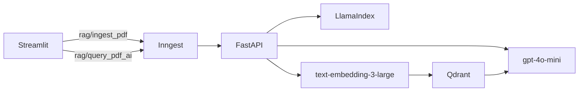

# Um PDF entra. Uma pergunta sai com fonte.

Mini pipeline de RAG para documentos locais. O Streamlit só abre a porta. Quem trabalha é uma função durável no Inngest: ela fatia o PDF, gera embeddings e grava no Qdrant. Na hora da pergunta, o mesmo caminho recupera os trechos e o `gpt-4o-mini` responde preso a esse contexto.

Feito para rodar na máquina, com fila, limite e observabilidade, sem transformar o notebook num servidor.

## O caminho de um arquivo



1. O upload grava o PDF em `uploads/` e dispara `rag/ingest_pdf` com o caminho e o nome do arquivo.
2. `load-and-chunk` lê o PDF e corta o texto em pedaços de 1000 caracteres, com 200 de sobreposição.
3. `embed-and-upsert` gera vetores de 3072 dimensões e faz upsert na coleção `docs`. O id de cada ponto é um UUID v5 de `arquivo:índice`, então reindexar o mesmo PDF substitui os pontos em vez de duplicar.
4. Uma pergunta dispara `rag/query_pdf_ai`. A interface espera a run terminar, consulta o servidor local do Inngest e mostra a resposta junto com os arquivos de onde os trechos saíram.

A ingestão aceita no máximo 2 execuções por minuto e, para o mesmo arquivo, no máximo 1 a cada 4 horas.

## O que cada arquivo faz

| Arquivo | Papel |
| --- | --- |
| `streamlit_app.py` | Upload, pergunta e espera da resposta |
| `main.py` | Funções Inngest de ingestão e consulta |
| `data_loader.py` | Leitura do PDF, chunking e embeddings |
| `vector_db.py` | Coleção, upsert e busca por cosseno no Qdrant |
| `custom_types.py` | Contratos entre os steps |

O cliente do Qdrant está fixado em `1.15.1` porque essa versão ainda expõe `QdrantClient.search`, o método usado na busca.

## Subir na sua máquina

Você precisa de Python 3.13, [uv](https://docs.astral.sh/uv/), Docker, Node.js e uma chave da OpenAI.

```bash
uv sync
cp .env.example .env
```

Coloque a chave em `OPENAI_API_KEY` e abra quatro processos:

```bash
docker run --rm -p 6333:6333 \
  -v "$(pwd)/qdrant_storage:/qdrant/storage" \
  qdrant/qdrant
```

```bash
uv run uvicorn main:app --reload
```

```bash
npx inngest-cli@latest dev -u http://127.0.0.1:8000/api/inngest
```

```bash
uv run streamlit run streamlit_app.py
```

A interface fica em `http://localhost:8501`. O painel do Inngest fica em `http://127.0.0.1:8288`, e é lá que dá para ver cada step da ingestão e da resposta.

PDFs, o volume do Qdrant e o `.env` ficam de fora do Git.
